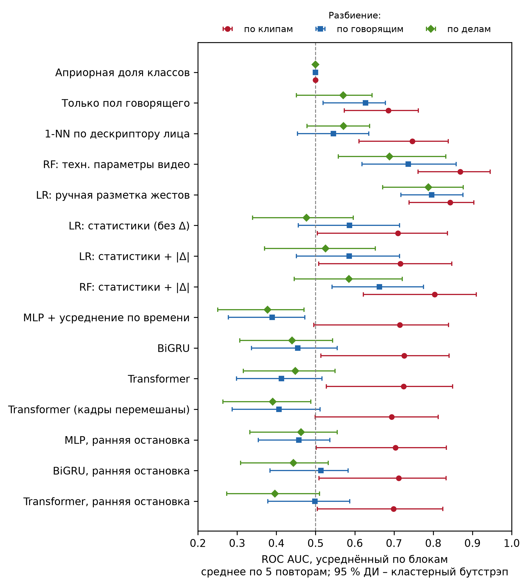

# Протокол оценки и «короткие пути» в распознавании обмана по видео: эксперимент на Real-life Trial

Технические материалы эксперимента: код, конфигурации, разметка говорящих, сохранённые разбиения,
предсказания для каждого клипа, метрики, доверительные интервалы, графики и логи. Все числа и
графики можно пересчитать из этого репозитория одним скриптом (`run_all.sh`).

*Evaluation protocol and shortcut audit for video-based deception detection on the Real-life
Trial corpus: code, speaker annotation, cross-validation splits, per-clip out-of-fold
predictions, metrics with cluster-bootstrap CIs, figures and logs. Documentation is in Russian.*

## Что исследуется

Насколько качество распознавания обмана по лицевой динамике (52 blendshape-коэффициента и поза
головы MediaPipe) на корпусе Real-life Trial (RLT; 121 клип, 56 говорящих, 32 судебных дела)
зависит от протокола разбиения: по клипам, по говорящим или по судебным делам? Дают ли временные
модели (BiGRU, Transformer) преимущество над порядко-инвариантными? Какого качества достигают
«короткие пути» – классификаторы только по личности, полу или техническим параметрам видео?

Гипотезы H1–H5 зафиксированы до запуска моделей; все последующие изменения плана описаны в
журнале отклонений (`HYPOTHESES.md`). Корпус, разметка говорящих и протоколы – в
`DATA_AND_PROTOCOL.md`.

## Основной результат

ROC AUC, вычисленный внутри тестовых блоков и усреднённый: среднее по 5 повторам 10-кратной
кросс-валидации (данные делятся на 10 блоков, каждый из которых по очереди служит тестовым) [95 % ДИ, кластерный бутстрэп по говорящим, B = 1000]. Полная таблица –
`results/aggregate/main_table.md`, парные сравнения – `results/aggregate/paired_comparisons.md`.

| Модель | По клипам | По говорящим | По делам |
|---|---|---|---|
| 1-NN по дескриптору лица (только личность) | 0,75 [0,61; 0,84] | 0,55 [0,45; 0,64] | 0,57 [0,48; 0,64] |
| RF по техническим параметрам видео | 0,87 [0,76; 0,95] | 0,74 [0,62; 0,86] | 0,69 [0,56; 0,83] |
| Только пол говорящего | 0,69 [0,57; 0,76] | 0,63 [0,52; 0,68] | 0,57 [0,45; 0,64] |
| LR по ручной разметке жестов MUMIN | 0,84 [0,74; 0,90] | 0,80 [0,72; 0,88] | 0,79 [0,67; 0,88] |
| LR: статистики кадров + \|Δ\| | 0,72 [0,51; 0,85] | 0,59 [0,45; 0,71] | 0,53 [0,37; 0,65] |
| RF: статистики кадров + \|Δ\| | 0,80 [0,62; 0,91] | 0,66 [0,54; 0,78] | 0,58 [0,45; 0,72] |
| MLP + усреднение по времени | 0,71 [0,50; 0,84] | 0,39 [0,28; 0,47] | 0,38 [0,25; 0,47] |
| BiGRU | 0,73 [0,51; 0,84] | 0,45 [0,34; 0,56] | 0,44 [0,31; 0,54] |
| Transformer | 0,72 [0,53; 0,85] | 0,41 [0,30; 0,52] | 0,45 [0,32; 0,55] |
| Transformer, ранняя остановка | 0,70 [0,50; 0,82] | 0,50 [0,38; 0,59] | 0,40 [0,27; 0,51] |

Кроме того, объединённый по блокам (pooled) AUC при групповой кросс-валидации смещён вниз:
модель, предсказывающая только долю классов в обучающей части блока (`prior`), получает pooled
AUC 0,34 при разбиении по говорящим (`results/aggregate/main_table.md`, метрика `auc`).



## Состав репозитория

```
HYPOTHESES.md            исследовательский вопрос, гипотезы H1–H5 (до запуска) и журнал отклонений
DATA_AND_PROTOCOL.md     корпус, разметка говорящих, группы «дело», протоколы разбиения
configs/                 extract.yaml (признаки), experiment.yaml (модели и гиперпараметры), aggregate.yaml
src/                     код эксперимента (модули описаны ниже)
tools/                   листы для ручной проверки разметки (кадры корпуса не публикуются)
metadata/                speaker_annotation.csv, target_face.csv, clips.csv
splits/                  15 сохранённых разбиений (3 протокола × 5 зёрен) + summary.csv
results/predictions/     out-of-fold вероятности для каждого клипа, модели, протокола и зерна
results/metrics_raw.csv  метрики каждого повтора
results/aggregate/       средние, 95 % ДИ, парные сравнения, декомпозиция по парам, сводки по блокам
                         и ранней остановке
results/audit/           аудит корпуса: структура, связь параметров записи с меткой, идентифицируемость
results/figures/         графики
results/model_params.json число параметров нейросетей
logs/                    логи извлечения признаков, обучения по блокам, агрегации
checksums.sha256         контрольные суммы архива RLT и моделей
requirements.lock.txt    точные версии пакетов
run_all.sh               полный прогон
```

### Модули `src/`

| Модуль | Назначение |
|---|---|
| `detect_faces.py` | детекция лиц (YuNet) и дескрипторы (SFace) на 10 кадрах/с, кандидаты целевого лица |
| `extract_features.py` | покадровые признаки MediaPipe Face Landmarker: 52 blendshape + yaw, pitch, roll |
| `build_metadata.py` | метаданные клипов: метка, говорящий, пол, дело, параметры видео |
| `splits.py` | разбиения по клипам, говорящим и делам (StratifiedKFold / StratifiedGroupKFold) |
| `audit.py` | аудит корпуса: структура, связь параметров записи с меткой, идентифицируемость говорящих |
| `data.py` | загрузка признаков, статистики кадров, ручная разметка жестов, параметры видео |
| `models.py` | MLP с усреднением по времени, BiGRU, Transformer-энкодер; обучение, ранняя остановка |
| `run_experiment.py` | все модели × протоколы × повторы, out-of-fold предсказания |
| `aggregate.py` | средние, AUC внутри блоков, кластерный бутстрэп, парные сравнения |
| `pair_analysis.py` | разведочная декомпозиция AUC на пары внутри и между говорящими |
| `count_params.py` | число обучаемых параметров нейросетей |
| `figures.py` | графики из `results/` |

### Модели (`configs/experiment.yaml`)

| Имя | Описание |
|---|---|
| `prior` | доля обманных клипов в обучающей части (диагностика) |
| `gender` | доля обманных клипов среди людей того же пола в обучении (аудит) |
| `identity_1nn` | метка обучающего клипа с ближайшим дескриптором лица SFace (аудит личности) |
| `metadata_rf` | RF по разрешению, fps, длительности и битрейту (аудит источника записи) |
| `gesture_logreg` | LR по 39 признакам ручной разметки MUMIN (ориентир) |
| `stat_nodelta_logreg` | LR по mean, std, p10, p90 покадровых признаков |
| `stat_logreg`, `stat_rf` | то же + средний модуль первой разности; LR и RF |
| `framepool` | покадровый MLP + усреднение и std по времени |
| `gru` | BiGRU |
| `transformer` | Transformer-энкодер, 2 слоя, d = 64 |
| `transformer_shuffled` | Transformer на кадрах со случайно переставленным порядком |
| `framepool_es`, `gru_es`, `transformer_es` | проверка устойчивости: число эпох выбирается ранней остановкой по внутренней валидации того же типа, что и внешнее разбиение |

## Данные

Видео, архив корпуса и модели в репозиторий не входят (каталог `data/` исключён из git).
Корпус RLT распространяется его авторами: Pérez-Rosas V., Abouelenien M., Mihalcea R., Burzo M.
Deception detection using real-life trial data // ICMI 2015. – P. 59–66. –
DOI 10.1145/2818346.2820758. `run_all.sh` скачивает архив и модели и проверяет их по
`checksums.sha256`.

Разметка говорящих (`metadata/speaker_annotation.csv`) выполнена вручную: идентификаторы
`S01`–`S56` условные, имена людей не используются.

## Воспроизведение

Требования: Python 3.12, `ffmpeg`/`ffprobe` в PATH, около 1 ГБ диска. Проверено на macOS 26.5
(Apple M5 Max, только CPU). Полный прогон занимает около 40 минут.

```bash
bash run_all.sh
```

Пошагово (`PY=.venv/bin/python`):

| Шаг | Команда | Результат |
|---|---|---|
| 1. Лица и дескрипторы | `$PY src/detect_faces.py --config configs/extract.yaml` | `data/derived/rlt_faces/`, `rlt_candidates/` |
| 2. Покадровые признаки | `$PY src/extract_features.py --config configs/extract.yaml` | `data/derived/rlt_mediapipe_10fps/*.npz` |
| 3. Метаданные | `$PY src/build_metadata.py` | `metadata/clips.csv` |
| 4. Разбиения | `$PY src/splits.py --config configs/experiment.yaml` | `splits/*.json`, `splits/summary.csv` |
| 5. Аудит корпуса | `$PY src/audit.py --config configs/experiment.yaml` | `results/audit/` |
| 6. Модели | `$PY -W ignore src/run_experiment.py --config configs/experiment.yaml` | `results/predictions/*.csv`, `results/metrics_raw.csv` |
| 7. Агрегация и ДИ | `$PY src/aggregate.py --config configs/aggregate.yaml` | `results/aggregate/` |
| 8. Декомпозиция по парам | `$PY -W ignore src/pair_analysis.py --config configs/aggregate.yaml` | `results/aggregate/pair_auc.*` |
| 9. Графики | `$PY src/figures.py --config configs/aggregate.yaml` | `results/figures/*.png` |

Ручная часть (уже выполнена, результаты в репозитории): `metadata/target_face.csv` – выбор
целевого лица в 3 клипах; `metadata/speaker_annotation.csv` – разметка говорящих и пола.

**Детерминированность.** Полный прогон с нуля воспроизвёл побитово файлы `results/predictions/`,
`results/aggregate/`, разбиения и метаданные; различаются только временные метки в логах и
порядок строк в `metrics_raw.csv`. Обучение нейросетей идёт на CPU в один поток, зёрна заданы для
каждого блока (`seed * 1000 + fold`). Варианты с ранней остановкой (`*_es`) добавлены отдельным
запуском; предсказания исходных моделей при этом воспроизводятся бит в бит.
